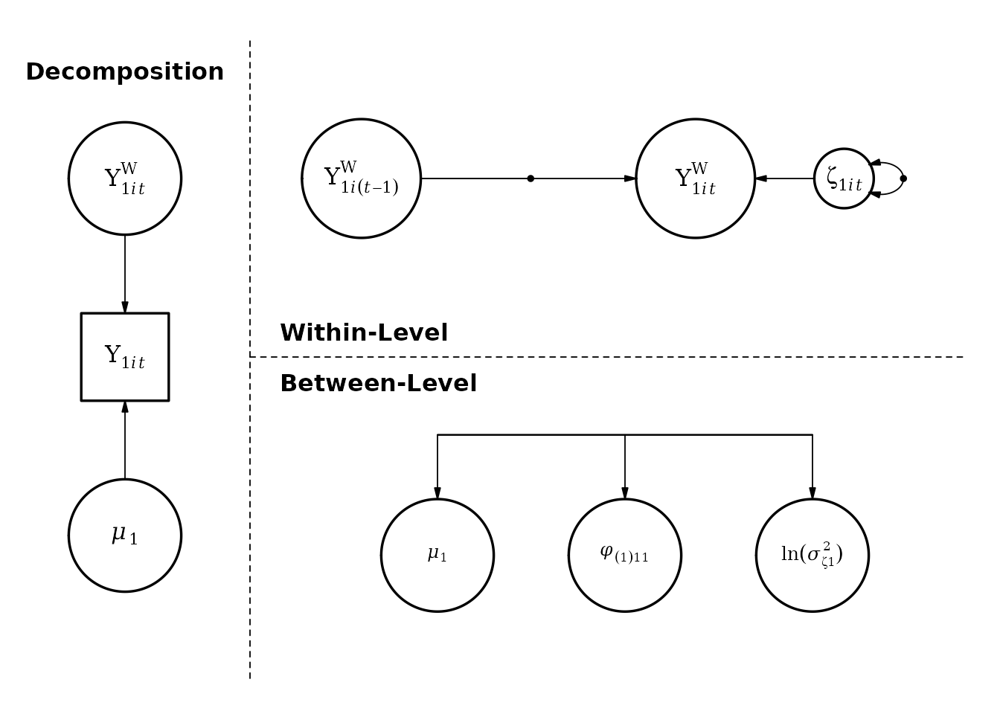

# A Simple Example: Multilevel Manifest AR(1) Model

``` r

library(mlts)
```

One of the simplest models we can fit with `mlts` is a multilevel first
order autoregressive model with only one observed variable. We start by
specifying the model with
[`mlts_model()`](https://munchfab.github.io/mlts/reference/mlts_model.md).
The argument `q` controls the number of time-series constructs. For this
simple model, the following call is sufficient:

``` r

ar1_model <- mlts_model(q = 1)
```

We can check the parameters present in the model by just calling the
object:

``` r

ar1_model
#>                              Model   Level             Type
#> mu_1                    Structural  Within     Fixed effect
#> phi(1)_11               Structural  Within     Fixed effect
#> ln.sigma2_1             Structural  Within     Fixed effect
#> sigma_mu_1              Structural Between Random effect SD
#> sigma_phi(1)_11         Structural Between Random effect SD
#> sigma_ln.sigma2_1       Structural Between Random effect SD
#> r_mu_1.phi(1)_11        Structural Between   RE correlation
#> r_mu_1.ln.sigma2_1      Structural Between   RE correlation
#> r_phi(1)_11.ln.sigma2_1 Structural Between   RE correlation
#>                                           Param             Param_Label
#> mu_1                                       mu_1                   Trait
#> phi(1)_11                             phi(1)_11                 Dynamic
#> ln.sigma2_1                         ln.sigma2_1 Log Innovation Variance
#> sigma_mu_1                           sigma_mu_1                   Trait
#> sigma_phi(1)_11                 sigma_phi(1)_11                 Dynamic
#> sigma_ln.sigma2_1             sigma_ln.sigma2_1 Log Innovation Variance
#> r_mu_1.phi(1)_11               r_mu_1.phi(1)_11                  RE Cor
#> r_mu_1.ln.sigma2_1           r_mu_1.ln.sigma2_1                  RE Cor
#> r_phi(1)_11.ln.sigma2_1 r_phi(1)_11.ln.sigma2_1                  RE Cor
#>                         isRandom prior_type prior_location prior_scale
#> mu_1                           1     normal              0        10.0
#> phi(1)_11                      1     normal              0         2.0
#> ln.sigma2_1                    1     normal              0        10.0
#> sigma_mu_1                     0     cauchy              0         2.5
#> sigma_phi(1)_11                0     cauchy              0         2.5
#> sigma_ln.sigma2_1              0     cauchy              0         2.5
#> r_mu_1.phi(1)_11               0        LKJ              1          NA
#> r_mu_1.ln.sigma2_1             0        LKJ              1          NA
#> r_phi(1)_11.ln.sigma2_1        0        LKJ              1          NA
```

When
[`mlts_model()`](https://munchfab.github.io/mlts/reference/mlts_model.md)
sets up this model, all model parameters are free (i.e., not
constrained) by default. On the within level, there are three fixed
effects: the grand mean (`mu_1`) of the outcome, the autoregressive
effect (`phi(1)_11`), and the natural log of the innovation variance
(`ln.sigma2_1`). The `(1)` in brackets for the autoregressive effect
parameter indicates a lag of first order, and the `_11` subscript
denotes that the first construct is as well predicted by the first
construct. Note that for the innovation variance, the natural log is
used to prevent the variance from dropping below zero. For each of these
effects, random effects are also estimated on the between level, which
are drawn from a multivariate normal distribution with zero mean.
Standard deviations of random effects are indicated with a `sigma_`
prefix, and random effect correlations are indicated with an `r_`
prefix.

A TeX formula for the above model can be obtained by calling the
[`mlts_model_formula()`](https://munchfab.github.io/mlts/reference/mlts_model_formula.md)
function on the model object. By default, the function produces an
RMarkdown file and renders it to a pdf file using `knitr`. However, the
TeX file can also be kept by calling `keep_tex = TRUE` within the
function call.

``` r

mlts_model_formula(ar1_model)
```

``` math
\text{Decomposition.}
```

``` math
\begin{gathered} \begin{bmatrix}
y_{1, it} \\
\end{bmatrix} = \begin{bmatrix}
\mu_{1,i} \\
\end{bmatrix}
+
\begin{bmatrix}
y_{1, it}^w \\
\end{bmatrix} \end{gathered}
```

``` math
\text{Within-level model.}
```

``` math
\begin{gathered} \begin{bmatrix}
y_{1, it}^w \\
\end{bmatrix} = \begin{bmatrix} \phi_{(1)11,i} \\ \end{bmatrix} \begin{bmatrix} y_{1,i(t - 1)}^w \\ \end{bmatrix} +  \begin{bmatrix} \zeta_{1, it} \\ \end{bmatrix} ,\\ 
\text{with}~\zeta_{1,it} \sim \mathit{N}(0, \sigma^2_{\zeta_{1},i})  \end{gathered}
```

``` math
\text{Between-level model.}
```

``` math
\begin{gathered} \begin{bmatrix} \mu_{1,i}\\
\phi_{(1)11,i}\\
\ln(\sigma^2_{\zeta_{1},i})\\ \end{bmatrix} = \begin{bmatrix} \gamma_{0,\mu_{1}}\\
\gamma_{0,\phi_{(1)11}}\\
\gamma_{0,\ln(\sigma^2_{\zeta_{1}})}\\ \end{bmatrix} +
  \begin{bmatrix} \upsilon_{\mu_{1},i}\\
\upsilon_{\phi_{(1)11},i}\\
\upsilon_{\ln(\sigma^2_{\zeta_{1}}),i}\\ \end{bmatrix} ,\\ 
\text{with}~
  \upsilon_{i} \sim \mathit{MVN}(\mathbf{0}, \mathbf{\Omega})  \end{gathered}
```

Furthermore, a path model can also be produced with the function
[`mlts_paths()`](https://munchfab.github.io/mlts/reference/mlts_paths.md)
with many options for adjustment.



By path model convention, rectangles represent observed variables and
circles represent latent (i.e., unobserved) variables. A single-headed
arrow represents a directed path (i.e., a regression), a double-headed
arrow represents (co-)variation, and a dot on a path indicates that this
parameter can vary across between-level units. To fit the above model,
we pass it together with the data set to
[`mlts_fit()`](https://munchfab.github.io/mlts/reference/mlts_fit.md).
The data set for this example is an artificial data set simulated from
an autoregressive model:

``` r

head(ar1_data)
#>   ID time    Y1
#> 1  1    1  1.16
#> 2  1    2 -0.29
#> 3  1    3  0.40
#> 4  1    4 -0.18
#> 5  1    5 -0.66
#> 6  1    6  0.42
```

We need to specify the variable in `data` that contains the time-series
process in the `ts` argument and the variable that contains the unit
identifier in the `id` argument. With the argument `tinterval`, the time
interval for approximation of a continuous time process can be specified
Asparouhov et al. (2018). We don’t specify it here, but see the Vignette
*Approximation of a Continuous Time Model* for more details.

``` r

ar1_fit <- mlts_fit(
  model = ar1_model,
  data = ar1_data,
  id = "ID",
  ts = "Y1",
  iter = 4000
)

saveRDS(ar1_fit, file = "../vignettes/ar1_fit.rds")
```

The model [`summary()`](https://rdrr.io/r/base/summary.html) shows
general information about the model and data:

``` r

summary(ar1_fit)
#> Time series variables as indicated by parameter subscripts: 
#>    1 --> Y1
#> Data: 2500 observations in 50 IDs
#> Model convergence criteria: 
#>   Maximum Potential Scale Reduction Factor (PSR; Rhat): 1.005 (should be < 1.01)
#>   Minimum Bulk ESS: 574 (should be > 200, 100 per chain) 
#>   Minimum Tail ESS: 864 (should be > 200, 100 per chain) 
#>   Number of divergent transitions: 0 (should be 0) 
#> 
#> Posterior Summary Statistics
#> Fixed Effects:
#>                Mean    SD   2.5%  97.5% Rhat Bulk_ESS Tail_ESS
#>         mu_1  0.733 0.090  0.560  0.913    1     4267     3055
#>    phi(1)_11  0.274 0.028  0.218  0.330    1     2081     2724
#>  ln.sigma2_1 -0.304 0.045 -0.390 -0.215    1     2445     2648
#> 
#> Random Effects SDs:
#>                     Mean    SD  2.5% 97.5%  Rhat Bulk_ESS Tail_ESS
#>         sigma_mu_1 0.598 0.069 0.479 0.752 1.000     3793     2800
#>    sigma_phi(1)_11 0.135 0.031 0.073 0.197 1.005      709      910
#>  sigma_ln.sigma2_1 0.232 0.044 0.150 0.324 1.001      934     1705
#> 
#> Random Effects Correlations:
#>                         Mean    SD   2.5% 97.5%  Rhat Bulk_ESS Tail_ESS
#>         mu_1.phi(1)_11 0.014 0.203 -0.387 0.412 1.001     2094     2947
#>       mu_1.ln.sigma2_1 0.216 0.184 -0.157 0.554 1.000     2401     2345
#>  phi(1)_11.ln.sigma2_1 0.124 0.264 -0.413 0.606 1.003      821     1899
#> 
#> Samples were drawn using NUTS on Mon Dec  8 09:33:20 2025.
#> For each parameter, Bulk_ESS and Tail_ESS are measures of effective
#> sample size, and Rhat is the potential scale reduction factor
#> on split chains (at convergence, Rhat = 1).
```

The line
`Time series variables as indicated by parameter subscripts: 1 --> Y1`
shows that model parameters indexed by a `1` refer to the variable `Y1`
in the data set. The `Model convergence criteria` provide an overview
across convergence diagnostics for all model parameters (i.e., also
parameters which are not printed in the
[`summary()`](https://rdrr.io/r/base/summary.html) by default). For the
simple AR1-model, all parameters converged well after 4,000 iterations.

The section `Fixed Effects` provides information about the fixed effects
in the model, i.e., $`\gamma_{0, \mu_1}`$, $`\gamma_{0, \phi_{(1)11}}`$,
and $`\gamma_{0,\ln(\sigma^2_{\zeta_{1}})}`$ in the above formula. For
example, the posterior mean of the autoregressive effect parameter
`phi(1)_11` is estimated at .274 with 95%-credible interval \[.218,
.330\]. The log variance of the innovations $`\zeta_{1t}`$ is estimated
at -.304.

The section `Random Effects SDs` shows standard deviations of the random
effects $`\upsilon_{\mu_{1},i}`$, $`\upsilon_{\phi_{(1)11},i}`$, and
$`\upsilon_{\ln(\sigma^2_{\zeta_{1}}),i}`$. The section
`Random Effects Correlations` shows correlations between random effects.
For example, while random effects of the person mean
$`\upsilon_{\mu_{1},i}`$ and the autoregressive effect
$`\upsilon_{\phi_{(1)11},i}`$ display nearly no correlation, 0.014,
there is a positive correlation between the person mean and log
innovation variance, 0.216. This indicates that individuals with a
higher person mean in the variable `Y1` also tend to have a higher
innovation variance.

## References

Asparouhov, T., Hamaker, E. L., & Muthén, B. (2018). Dynamic Structural
Equation Models. *Structural Equation Modeling: A Multidisciplinary
Journal*, *25*(3), 359–388.
<https://doi.org/10.1080/10705511.2017.1406803>
